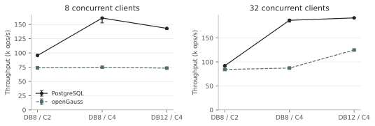

<div align="center">

# DBMS 的优势与性能比较

**直接文件操作 · PostgreSQL · openGauss**

<p>
  
  
  
  
</p>

[**阅读报告 · 7 页 PDF**](output/submission/report.pdf) · [提交源码](output/submission/filmbench.cpp) · [快速开始](#快速开始) · [复现指南](docs/复现指南.md)

</div>

本项目研究两个问题：**DBMS 相比直接文件操作有哪些优势？如何评价 PostgreSQL 与 openGauss 的表现？** 实验比较相同操作的耗时、吞吐量与尾延迟，验证外键约束和事务回滚，并通过索引对照与 CPU 资源干预分析差异。

## 先看结果

| 问题 | 实验观察 |
| :--- | :--- |
| 文件查询一定慢吗？ | 装载偏移索引后，长批次均匀点查平均每次 **3.29 μs**；但索引装载与校验约需 **0.380 s**，适合准备后反复读取静态记录。 |
| 人物索引有多大作用？ | 对固定返回 54 行的连接，五轮配对加速比中位数为 **PG 243.3 倍、OG 566.9 倍**。两库均从数百毫秒降到约 1 ms。 |
| 吞吐平台意味着数据库到极限了吗？ | 32 客户端时，将客户端绑定范围从 2 核增至 4 核，PG 吞吐从 **9.21 万次/s 增至 18.69 万次/s**；原配置的发压端限制了吞吐。 |
| 数据库提供了哪些一致性能力？ | 两库均拒绝非法外键引用；事务失败后，先前已执行的修改被回滚，四表摘要恢复一致。 |

前两项来自 2026-10-15 的共享服务器补测，点查为五轮平均单次耗时的中位数；CPU 干预来自独立实验。不同批次的源码计时边界、CPU 绑定及运行条件有差异，分别统计。补测观察到 SMT 兄弟核活动，完整范围与限制见报告第 07 节。

<p align="center">
  
</p>

<p align="center"><sub>10 倍数据的并发只读实验。DB / C 分别表示数据库与客户端绑定的 CPU 数；每个点展示三轮中位数及最小值至最大值。</sub></p>

## 项目内容

同一个客户端统一执行标题子串搜索、姓名 `T → Ttt` 更新、按编号点查、人物连接、国家/年份聚合，以及并发只读与混合读写负载。文件端包含顺序扫描和偏移索引；数据库端保存执行计划，并校验返回内容、更新行数、外键和回滚。

实验采用课程提供的电影数据集 `filmdb.sql`，用于构造上述测试负载。数据包含四张关联表；扩容保持关系并平移编号，国家表始终为 185 行：

| 规模 | 电影 | 人物 | 演职关系 |
| :--- | ---: | ---: | ---: |
| 1× | 9,204 | 16,489 | 46,850 |
| 10× | 92,040 | 164,890 | 468,500 |
| 100× | 920,400 | 1,648,900 | 4,685,000 |

复制扩容保持原字段分布，100× TSV 合计约 161 MiB，可以驻留内存；本项目没有测量超内存数据或长期持续写入。

## 快速开始

以下步骤适用于 Ubuntu/Linux，先运行文件端示例，无需启动数据库。

```bash
git clone https://github.com/luanmenglei/dbh_project1.git
cd dbh_project1

sudo apt-get update
sudo apt-get install -y build-essential libpq-dev python3
make
python3 scripts/prepare.py --scales 1

# 查找标题包含 The 的电影，预期 rows=1563
./build/filmbench --backend file --op search_rows \
  --data data/generated/s1 --keyword The

# 建立文件偏移索引，再按编号点查
./build/filmbench --backend file --op build_index --data data/generated/s1
./build/filmbench --backend file --op point \
  --data data/generated/s1 --indexed 1 --requests 1000
```

数据生成器拒绝覆盖已有目录。数据库部署、匹配 openGauss 的 libpq、连接变量及完整实验命令见 [复现指南](docs/复现指南.md) 和 [用户目录部署](docs/用户目录部署.md)。

## 阅读与复现

| 你想做什么 | 从这里开始 |
| :--- | :--- |
| 阅读结论和实验设计 | [最终报告](output/submission/report.pdf) |
| 查看或提交 C++ 源码 | [开发源码](src/filmbench.cpp) · [提交副本](output/submission/filmbench.cpp) |
| 修改报告文字或署名 | [Typst 源文件](report/report.typ) · [导出的数据](report/data.json) |
| 核对某个实验数字 | [实验记录索引](results/README.md) |
| 编译、部署、重跑实验 | [复现指南](docs/复现指南.md) |
| 查看设计与修订过程 | [文档索引](docs/README.md) |
| 核对交付文件 | [SHA-256 清单](output/submission-manifest.json) |

仅编译文稿可直接使用仓库中的数据与 SVG，无需运行数据库：

```bash
# 需要 Typst 0.14.2 或兼容版本；Linux 示例使用已安装的 Noto Sans CJK SC
typst compile --input 'font=Noto Sans CJK SC' report/report.typ report.pdf

# 从完整证据重新审查数字、绘图并生成提交文件
python3 -m pip install -r requirements-plots.txt
python3 scripts/build_typst_report.py --font 'Noto Sans CJK SC'
```

Windows 默认字体为 Microsoft YaHei。署名可通过 `--input name=姓名 --input student-id=学号` 传给 Typst；当前提交稿姓名与学号留空。完整构建会同时更新 PDF、提交源码副本与哈希清单。

## 仓库导航

```text
src/                    C++17 主程序
sql/                    数据库表结构
data/source/            课程原始 SQL
scripts/                数据准备、运行器、证据审查与报告构建
tests/                  功能与实验流程回归测试
report/                 Typst 文稿、数据摘要和 SVG 图表
output/submission/      最终 report.pdf 与 filmbench.cpp
results/                已完成实验的原始记录和源码快照
experiments/            原主实验源码基线
docs/                   复现、部署、设计与修订记录
project1.pdf            课程要求
```

仓库保留原始 stdout、资源采样、请求文件与源码快照，便于从报告数字追溯到实际运行。数据库状态、连接凭据、编译产物、临时文件、旧版 PDF 和新实验临时目录由 `.gitignore` 排除。原主实验的重复摘要目录已从上传内容中移除，完整记录统一保存在 `results/epyc-compact-evidence/`。

## 验证与实验记录

- 原主实验：**318 条计时记录**，覆盖三个数据规模。
- CPU 资源实验：**76 轮**，含资源干预、平衡配置和 120 秒确认。
- 新补测：**110 项测量**，包含 **300 万次正式点查**、60 次分层人物连接与 20 次人物索引对照。
- 功能验证：独立 Python oracle、索引损坏拒绝、失败重建保留原索引、外键拒绝与事务回滚。

本地运行器及证据审查测试不需要启动数据库：

```bash
python3 -m unittest discover -s tests -p 'test_*.py'
```

Linux 完整集成检查使用 `make test`，另需安装 PostgreSQL 服务端工具；测试创建独立临时集群。完整验证说明见 [复现指南](docs/复现指南.md)。

报告正文由 DeepSeek Harness 协助主笔，实验执行、证据核对与逐页排版检查另行完成；[写作与验证记录](docs/DeepSeek审查记录.md) 保留了来源和修订过程。
