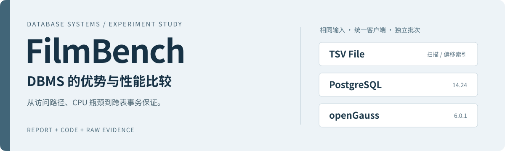
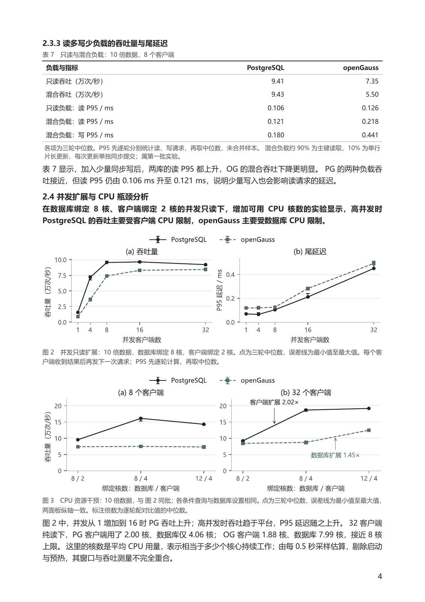

<div align="center">



**一份从实验结果追溯到原始记录的数据库性能研究。**

[](src/filmbench.cpp)
[](docs/复现指南.md)
[](docs/用户目录部署.md)
[](output/submission/report.pdf)

[**阅读报告**](output/submission/report.pdf) · [**快速开始**](#快速开始) · [**复现实验**](docs/复现指南.md) · [**原始证据**](results/README.md)

</div>

本项目研究 **DBMS 相比直接文件操作提供了什么，以及如何比较 PostgreSQL 与 openGauss**。同一个 C++ 客户端执行查询、更新和并发负载；通过访问路径对照、CPU 资源干预与失败事务验证，解释耗时、吞吐量、尾延迟和一致性保证。

| 阅读目的 | 入口 |
| :--- | :--- |
| 看实验设计与结论 | [5 页报告](output/submission/report.pdf)，含 3 幅图、7 张表 |
| 跑通一个完整示例 | [快速开始](#快速开始)，附预期查询结果 |
| 复核某个数字 | [逐批记录索引](results/README.md) → 原始输出、资源采样与源码快照 |

[核心发现](#核心发现) · [实验覆盖](#实验覆盖) · [方法与边界](#方法与边界) · [复现与验证](#复现与验证) · [仓库导航](#仓库导航)

## 核心发现

| 问题 | 实验观察 |
| :--- | :--- |
| 文件查询一定慢吗？ | 装载偏移索引后，长批次均匀点查平均每次 **3.29 μs**；但索引装载与校验约需 **0.380 s**，适合准备后反复读取静态记录。 |
| 人物索引有多大作用？ | 对固定返回 54 行的连接，五轮配对加速比中位数为 **PG 243.3 倍、OG 566.9 倍**。两库均从数百毫秒降到约 1 ms。 |
| 吞吐平台意味着数据库到极限了吗？ | 32 客户端时，将客户端绑定范围从 2 核增至 4 核，PG 吞吐从 **9.21 万次/s 增至 18.69 万次/s**；原配置的发压端限制了吞吐。 |
| 数据库提供了哪些一致性能力？ | 两库均拒绝非法外键引用；事务失败后，先前已执行的修改被回滚，四表摘要恢复一致。 |

点查与索引对照来自 [2026-10-15 补测](results/supplement-20261015-metadata/analysis.json)，CPU 干预来自 [独立实验](results/scaling-probe/)。点查为五轮平均单次耗时的中位数；不同批次的计时边界与 CPU 绑定不同，分别统计。报告第 2.2 节展示历史短批次点查，长批次补测的完整范围见上述审查统计；索引对照与 CPU 干预见报告第 2.1、2.4 节。

<p align="center">
  
</p>

<p align="center"><sub>10 倍数据，并发只读。横轴为数据库 / 客户端绑定核数；点为三轮中位数，误差线为最小值至最大值。倍数为逐轮配对比值的中位数。</sub></p>

## 实验覆盖

| 问题 | 对照与负载 | 观察指标 |
| :--- | :--- | :--- |
| 访问路径如何改变查询成本？ | 文件扫描、文件偏移索引、数据库主键读取；同库有 / 无人物索引 | 平均单次耗时、操作耗时、准备成本、执行计划 |
| 扫描与写入如何表现？ | 标题子串计数 / 返回记录、国家年份聚合、姓名 `T → Ttt` 更新 | 端到端耗时、返回行数、更新行数 |
| 吞吐量在哪里受限？ | 1–32 客户端并发只读，客户端 / 数据库 CPU 绑定干预 | 吞吐量、P95、近似平均忙核 |
| 少量同步写有什么影响？ | 只读与约 90% 读 + 10% 写 | 读 P95、写 P95、整体吞吐量 |
| 数据库提供了哪些保证？ | 非法外键插入、失败事务回滚 | 错误码、片长原值、四表内容摘要 |

<details>
<summary>查看报告版式与 CPU 瓶颈分析页</summary>

<a href="output/submission/report.pdf"></a>

预览直接来自交付 PDF。修改报告后可运行 `python3 scripts/build_readme_assets.py` 更新，需要 Poppler。

</details>

## 快速开始

需要 Ubuntu/Linux、C++17、libpq 开发库和 Python 3.9+。先跑文件端示例，无需启动数据库：

```bash
git clone https://github.com/luanmenglei/dbh_project1.git
cd dbh_project1

sudo apt-get update
sudo apt-get install -y build-essential libpq-dev python3
make
python3 scripts/prepare.py --scales 1

# 查找标题包含 The 的电影，预期 rows=1563
./build/filmbench --backend file --op search_rows \
  --data data/generated/s1 --keyword The

```

预期输出中包含 `rows=1563`，表示匹配 1,563 部电影。`search_count` 则返回一条计数结果，不能按其 `rows` 判断匹配数。

<details>
<summary>继续体验：建立偏移索引并执行 1,000 次点查</summary>

```bash
# 在刚生成的同一份数据上执行
./build/filmbench --backend file --op build_index --data data/generated/s1
./build/filmbench --backend file --op point \
  --data data/generated/s1 --indexed 1 --requests 1000
```

</details>

数据生成器拒绝覆盖已有目录。数据库部署、匹配 openGauss 的 libpq、连接变量及完整实验命令见 [复现指南](docs/复现指南.md) 和 [用户目录部署](docs/用户目录部署.md)。

## 方法与边界

实验运行于共享 Ubuntu 22.04 服务器，双路 AMD EPYC 7542、NVMe；两库轮流运行，各限 8 GiB 内存。数据来自课程电影数据集 `filmdb.sql`，复制后三表并平移编号以保持关系，国家表固定 185 行。

| 规模 | 电影 | 人物 | 演职关系 |
| :--- | ---: | ---: | ---: |
| 1× | 9,204 | 16,489 | 46,850 |
| 10× | 92,040 | 164,890 | 468,500 |
| 100× | 920,400 | 1,648,900 | 4,685,000 |

- **统计口径：** 通常三轮中位数与最小值至最大值；长批次补测为五轮。点查先逐轮求平均，P95 先逐轮计算，再取中位数。120 秒确认每条件只有一轮。
- **公平性检查：** 核对查询内容与更新结果，恢复更新初始状态，记录源码哈希；索引对照保持查询、数据及结果量不变。
- **适用范围：** 100× TSV 约 161 MiB，可驻留内存；数据已预热，复制扩容保留原字段分布。未覆盖超内存数据、长期持续写入或所有隔离级别与崩溃恢复场景。
- **共享资源：** CPU 绑定并非独占，补测观测到 SMT 兄弟核活动；不同批次与计时版本不合并，也不据跨批差值推算优化收益。

实验条件与计时边界见 [报告第 2 节](output/submission/report.pdf)，完整参数及实验限制见 [复现指南](docs/复现指南.md)。

## 复现与验证

| 路径 | 需要什么 | 得到什么 |
| :--- | :--- | :--- |
| 阅读结果 | PDF 阅读器 | 完整设计、结果与限制 |
| 运行文件示例 | Linux、C++17、libpq、Python | 查询与索引功能演示 |
| 审查已保存证据 | Python、仓库中的结果文件 | 计时矩阵、摘要及源码身份核验 |
| 重建报告 | Python 绘图库、Typst、中文字体 | SVG、PDF、提交源码副本与哈希清单 |
| 重跑数据库实验 | 专用数据库、对应 libpq、资源配置 | 新批次结果；步骤见 [完整指南](docs/复现指南.md) |

```bash
# 本地运行器与证据审查回归，不启动数据库
python3 -m unittest discover -s tests -p 'test_*.py'

# 审查已保存的原主实验
python3 scripts/analyze_results.py results/epyc-compact-evidence
```

仅编译文稿可直接使用仓库中的数据与 SVG，无需运行数据库：

```bash
# Typst 0.14.2 或兼容版本；示例字体需预先安装
typst compile --input 'font=Noto Sans CJK SC' report/report.typ report.pdf

# 审查完整证据、重新绘图并生成交付文件
python3 -m pip install -r requirements-plots.txt
python3 scripts/build_typst_report.py --font 'Noto Sans CJK SC'
```

Windows 默认字体为 Microsoft YaHei。署名默认使用源稿中的姓名与学号，可通过 `--input name=姓名 --input student-id=学号` 传给 Typst，或用构建脚本的 `--name`、`--student-id` 参数覆盖。Linux 完整集成检查使用 `make test`，另需 PostgreSQL 服务端工具；三后端验证的范围见 [复现指南](docs/复现指南.md)。

<details>
<summary>已保存的实验与验证规模</summary>

- 原主实验：**318 条计时记录**，覆盖三个数据规模。
- CPU 资源实验：**76 轮**，含资源干预、平衡配置及 120 秒确认。
- 长批次补测：**110 项测量**，含 **300 万次正式点查**、60 次分层人物连接和 20 次人物索引对照。
- 功能验证：独立 Python oracle、索引损坏拒绝、失败重建保留原索引、外键拒绝与事务回滚。

这些数字来自不同批次，各自的输入、配置、源码与统计方式见 [实验记录索引](results/README.md)。

</details>

## 仓库导航

```text
src/                    C++17 客户端
sql/                    数据库表结构
scripts/                数据准备、实验运行、证据审查与报告构建
report/                 Typst 源稿、数据摘要和矢量图
output/submission/      交付报告与 C++ 源码
results/                原始输出、资源采样与源码快照
experiments/            原主实验源码基线
tests/                  功能与实验流程回归
docs/                   复现指南、审查记录与展示资产
data/source/            课程原始数据
```

[提交源码](output/submission/filmbench.cpp) · [SHA-256 清单](output/submission-manifest.json) · [文档索引](docs/README.md) · [课程要求](project1.pdf)

源码保留单文件，分为 11 个带中文说明的折叠区域，`main` 内再分为 5 个步骤。建议先读 04（SQL）、05（文件更新）、09（文件查询），再读 11（实验执行）和 10（并发）。VS Code 中可依次按 `Ctrl+K`、`Ctrl+8` 折叠全部区域，`Ctrl+K`、`Ctrl+9` 展开区域，也可点击区域旁的折叠箭头。折叠标记用 `_MSC_VER` 保护，Linux 编译时跳过。

注释版只添加阅读说明与折叠标记，已有代码行保持原样。[版本对应记录](docs/source-readability.json) 保存交付源码与已验证实验源码的各自哈希；报告构建检查两者差异仅为允许的插入，不将注释版标为重新运行过的实验。

数据库状态、连接凭据、生成数据与临时产物由 `.gitignore` 排除。新增实验使用独立目录，既有原始记录保留用于追溯。

## 反馈与来源

复现问题和改进建议可提交到 [Issues](https://github.com/luanmenglei/dbh_project1/issues)；请附提交版本、命令、环境及相关日志。新增实验和验证约定见 [贡献说明](CONTRIBUTING.md)。

报告正文由 DeepSeek Harness 协助主笔，实验执行、证据核对与逐页排版检查另行完成；[写作与验证记录](docs/DeepSeek审查记录.md) 保留了来源和修订过程。

首页组织参考 [sysbench](https://github.com/akopytov/sysbench)、[ClickBench](https://github.com/ClickHouse/ClickBench) 和 [BenchBase](https://github.com/cmu-db/benchbase)，使用本项目自己的文字、图表与实验结果。[展示设计记录](docs/仓库展示设计.md) 说明具体借鉴方式。
